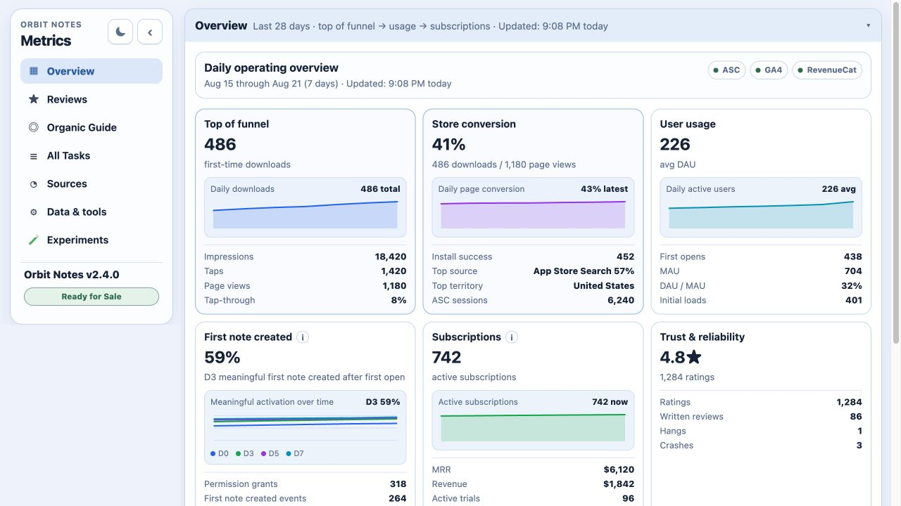

# app-metrics-dashboard

A local, config-driven operating dashboard for independent iOS apps. It brings App Store Connect acquisition, public ratings and reviews, Firebase / GA4 activation and retention, RevenueCat subscription health, ASO experiments, and a lightweight growth checklist into one place.



The tool is intentionally local: credentials stay on your machine, fetched data is written to your app workspace, and the browser UI is served on `127.0.0.1`.

## What it covers

- App Store impressions, product-page views, downloads, installs, sessions, territories, referrers, subscriptions, crashes, and hangs
- Public App Store rating health plus written-review themes
- Configurable GA4 funnel events, D0 / D3 / D5 / D7 activation cohorts, DAU, MAU, paywall exposure, and two feature-adoption signals
- RevenueCat revenue, MRR, customers, trials, conversion, churn, active subscriptions, and country splits
- Archived metadata experiments with pre/post outcome comparisons
- App-specific growth context and task checklists loaded from Markdown

## Requirements

- Python 3.11+
- [asc](https://github.com/rudrankriyam/App-Store-Connect-CLI) authenticated for App Store Connect analytics and reviews
- Optional: a Firebase service account with access to the app's GA4 BigQuery export
- Optional: a RevenueCat secret API key and project ID

## Quick start

```sh
git clone https://github.com/rckim77/app-metrics-dashboard.git
cd app-metrics-dashboard
python3 -m venv .venv
.venv/bin/pip install -r requirements.txt
cp config.example.json /path/to/your-app/metrics-dashboard.json
cp metrics-dashboard.env.example /path/to/your-app/metrics-dashboard.env
Scripts/dashboard.sh --config /path/to/your-app/metrics-dashboard.json
```

Open [http://127.0.0.1:8765](http://127.0.0.1:8765).

To explore the UI immediately with synthetic data:

```sh
Scripts/dashboard.sh --config examples/demo/dashboard.json
```

The config belongs with the consuming app, not this tool. That keeps app IDs, event conventions, experiment history, and growth notes versioned alongside the product while the dashboard engine remains reusable.

## App config

`config.example.json` documents the complete schema. The key sections are:

| Section | Purpose |
| --- | --- |
| `app` | Display name, slug, App Store app ID, and platform |
| `workspace` | App root, optional Xcode project file, and generated metrics directory/file |
| `firebase` | BigQuery project, optional dataset, and local credential-file patterns |
| `analytics` | First-open, permission, initial-load, activation, paywall, and feature event mappings |
| `ui` | Human-readable activation/value/feature labels and value formatting |
| `content` | Optional app context, growth tasks, and ASO experiment JSON paths |

Every relative path is resolved predictably: `workspace.root` is relative to the config file; workspace files are relative to that root; content, credential patterns, and the env file are relative to the config file.

Example activation mapping:

```json
{
  "analytics": {
    "firstOpenEvent": "first_open",
    "activationEvent": "onboarding_completed",
    "activationValueParameter": "items_created",
    "meaningfulActivationMinimum": 1,
    "paywallEvent": "paywall_presented",
    "primaryFeatureEvent": "share_completed",
    "secondaryFeatureEvent": "import_completed"
  },
  "ui": {
    "activationLabel": "Onboarding completion",
    "activationValueLabel": "Items created",
    "activationValueUnit": "number",
    "featureLabels": ["Sharing", "Imports"]
  }
}
```

Use `"activationValueUnit": "storage"` when the value is stored in bytes.

## Credentials

Secrets are read from exported environment variables or the configured `metrics-dashboard.env` file. The env file is gitignored here and should also be ignored by the consuming app.

The dashboard never needs your app's client-side RevenueCat SDK key. Use a server-side RevenueCat secret key (`sk_…`) and project ID.

For Firebase, set `GOOGLE_APPLICATION_CREDENTIALS` or list one or more local patterns under `firebase.credentialFiles`. The first matching JSON file is used.

## Commands

Run the local app:

```sh
Scripts/dashboard.sh --config /path/to/app/metrics-dashboard.json
```

Build or refresh the metrics JSON directly:

```sh
.venv/bin/python Scripts/fetch_metrics.py \
  --config /path/to/app/metrics-dashboard.json \
  --days 28 \
  --chart-days 90
```

Validate the Python code and config tests:

```sh
.venv/bin/python -m unittest discover -s tests
```

## Local API

- `GET /api/config` — public app identity, labels, context, and tasks
- `GET /api/metrics` — cached combined metrics JSON
- `GET /api/status` — source setup, paths, and current App Store version
- `GET /api/refresh-progress` — active source-refresh progress
- `GET /api/aso-monitor` — rebuilt experiment scorecard
- `GET/POST /api/aso-monitor-config` — read or update the configured ASO experiment file
- `POST /api/refresh` — refresh all enabled sources
- `POST /api/refresh-source` — refresh `asc`, `firebase`, or `revenueCat`
- `POST /api/refresh-reviews` — load written reviews on demand
- `POST /api/refresh-cancel` — stop an in-flight source refresh

## Origins

This project began as the private operating dashboard for the iOS app **This Day**. The standalone version moves app identity, workspace paths, analytics conventions, feature labels, credentials, experiment history, and growth content into the consuming app's config. This Day now uses the same public engine as any other configured app.

MIT licensed. Use and adapt it for your own app; no support guarantees.
